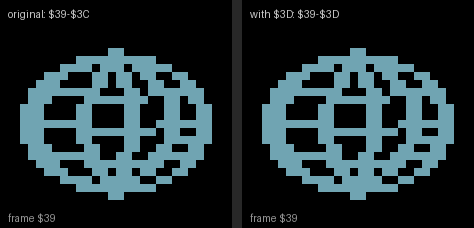
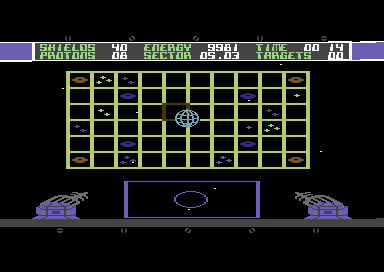

# Forty-two-year-old bugs in Sentinel – and a planet that finally turns smoothly

*We are porting Synapse Software's 1984 game Sentinel to the C128. Along the way we
compared the C64 original with the port routine by routine, and a few bugs that have
been hiding in the code since 1984 turned up.*

## How we found them

The C128 port is not a rewrite: we carry the original 6502 routines over, and every
routine we carry over is checked against the original. For that we use a C64/C128
emulator written in JavaScript. It runs both programs with the same inputs and
compares what they produce: positions, readings, radar marks, over hundreds of random
cases. Where the two differ, the bug is either in the port or in the original. The
second kind made this list.

For each bug we describe what the code does, what it causes in play, and what became
of it. The **C64 1351 patch** (mouse support for the original game) fixes some of
them; the **C128 port** either fixes them or keeps them on purpose, so that the
side-by-side tests stay exact.

## 1. A kill near the top of the screen: a crash

When our shot hits a fighter, the game works out the explosion's centre from the
sprite's position. It pushes the x half onto the stack (`$32FE PHA`). If the sprite's
y is above 60, or at 240 and below, the code (`$3323`/`$3329`) branches to `$3337`,
past the `PLA` at `$332B`. The byte stays on the stack. The routine is called from the
raster interrupt, so its `RTS` returns to an address made of that byte and half of the
real return address.

- **In play:** rare, since a fighter shown that high is mostly behind the HUD. But when
  it happens, the interrupt returns into nowhere: a crash or a hang.
- **How we found it:** the side-by-side test crashed the original ("illegal opcode
  $A7 at $F354").
- **C128 port:** fixed (the missing `PLA`).

## 2. The enemy shot's starting direction: computed, then thrown away

At launch the code reads the firing fighter's movement stream to give the shot a
starting direction, then overwrites both results with zero (`$CA13`, `$CA35`). On top
of that, the self-modifying code that should point the read at the right fighter's
stream stores the wrong register (`STA` instead of `STY`, `$C9CC`), so the pointer
becomes the value of the VIC register `$D017`.

- **In play:** every enemy shot starts without a direction and only gets one from its
  screen position afterwards. Harmless, since the result is dropped anyway.
- **C128 port:** kept (the dead computation is left out).

## 3. `AND $04` instead of `AND #$04`

`$CB6C LDA $F7 / AND $04` was meant to be `AND #$04`, a test of bit 8 of the shot
sprite's x coordinate. When the shot is beyond x = 255, its sideways direction should
stay. But `$04` is a zero-page address: the low byte of fighter 1's stream pointer,
always `$00`. So the test never holds.

- **In play:** a shot that crosses x = 255 is steered as if it were at the left edge,
  and turns back left. Shots rarely get that far.
- **C128 port:** kept.

## 4. The second explosion checks x twice and y never

When an enemy shot reaches the ship, 12 points burst where it was (`$9DAA`). The
start-up loop stores x, then compares `A` (still x) against the y limits before it
loads y.

- **In play:** no effect, the shot's y always ends inside the range.
- **C128 port:** kept.

## 5. The tracking computer's planet masks come from zero page

While tracking, the aim builds a joystick-like mask that turns the planet. The bits
are cleared with `AND $FB`, `AND $F7`, `AND $FE`, `AND $FD`: zero page again, not the
immediates `#$FB`… the programmer meant. `$F7` is the shadow of the sprites' x bit 8;
the others hold whatever they hold.

- **In play:** while tracking, the planet moves in odd directions, or not at all.
  Mostly all four directions are on at once, and they cancel out.

## 6. After a jump the map's boxes stay in the picture

The map's cursor boxes are pixels of value 2. In flight that value is black, and the
stars and the hyperspace's erase both leave it alone. Only the map's other exit clears
the bitmap (`$FC4E JSR $BAB0`), so after a jump the boxes stay. They don't show on the
black sky, but a white flash brings them out, and stars vanish as they cross them.

- **In play:** black squares on the screen during hit flashes, until the map is next
  closed without a jump.
- **C64 patch:** fixed in v9 (a jump runs the same clear).

## 7. The planet that skipped a frame

This is our favourite, because you can see it. The sprite pointer of the planet that
turns on the map steps through the frames `$39`–`$3C` (`$109B CPY #$3D`). But sprite
shape `$3D` is there in memory (`$4F40`), and no code ever uses it. It is the fifth
frame.

We counted how many pixels change from one frame to the next:

| Step | Pixels changed |
|---|---|
| $39 → $3A | 67 |
| $3A → $3B | 74 |
| $3B → $3C | 81 |
| **$3C → $39** (the original's jump back) | **130** |
| $3C → $3D | 69 |
| $3D → $39 | 81 |

In the original the step from `$3C` back to `$39` is about twice as big as the others,
so the turn jerks once a cycle. `$3D` fills exactly that gap. It looks very much as if
the artist drew it and the programmer wrote a loop limit one too small.

On the left the original four frames, on the right five, at the map's pace (160 ms a
frame):

- **C64 patch:** fixed in v10. One byte: `CPY #$3E` instead of `CPY #$3D`.
- **C128 port:** fixed. In the C128 game pointer `$3D` is already taken (it holds the
  gun barrels' sprite), so the fifth frame moved to pointer `$FF`, in the bitmap area
  behind the bottom text strip.

## Quirks that are part of the game

Some things look like bugs but are part of how the game behaves, so the port keeps
them:

- The phasor shot's colour is read with `LDX $1520 / LDA $1520,X`. That lands on
  `$1527`, a byte of its own code (`$13`), which happens to be cyan.
- At the end of the shot's path the stored position is loaded from the sound flag:
  0 when no other sound is playing.
- A kill decrements the ones digit of the HUD's TARGETS display directly
  (`DEC $5476`), with no borrow into the tens.
- The system message reads "STELLER GRID UPDATE DESTROYED".

## Where to try it

- The browser version, with the C64 v10 and the C128 port:
  [bencepapa.github.io/sentinel-1351](https://bencepapa.github.io/sentinel-1351/)
- Source, the patch and the detailed notes (`FINDINGS.md`):
  [github.com/Bencepapa/sentinel-1351](https://github.com/Bencepapa/sentinel-1351)
