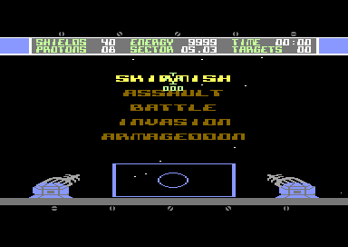

# Sentinel GUI assets and layout (C64 original)

Everything here is read from the C64 game (`Sentinel-1351_v9`) so the C128 port can
rebuild the cockpit. `python c128-gui/extract_sprites.py` regenerates the files in
`ref/` straight from the disk image; nothing has to be run in an emulator.


## Sprites (`ref/sprites-4800.bin`, `ref/sprites-sheet.png`)

All shapes are in VIC bank 1, 64 bytes each, addressed by a sprite pointer
(address = `$4000 + pointer * 64`). They are plain data in the disk image and
identical to the running game, so there is nothing to generate:

| pointers | address | what it is |
|---|---|---|
| `$20-$30` | `$4800-$4C3F` | enemy twin-pod fighters, tiny to close, in several rotations |
| `$31-$38` | `$4C40-$4E3F` | enemy ships (lens-shaped), one shape per distance (tiny to big); **multicolor** (user) |
| `$39-$3D` | `$4E40-$4FFF` | the planet, five globe frames (`$39-$3C` are cycled, see below) |
| `$3E-$44` | `$4F80-$513F` | small spiky shapes, growing: the type 2 ships; **multicolor** (user) |
| `$45`, `$46` | `$5140-$51BF` | blank on disk, **filled at run time** (see below) |
| `$47`, `$48` | `$51C0-$523F` | two big diagonal arms, mirrored: the gun barrels (left, right) |
| `$49-$4B` | `$5240-$52FF` | the tracking crosshair, animated |
| `$4C-$4E` | `$5300-$53BF` | corner marks, three sizes (crosshair at distance) |
| `$60-$63` | `$5800-$58FF` | explosion, four growing frames |
| `$64` | `$5900` | the digits 0-9, 8x5 pixels each: the source of the numbers shown in the three squares of `$7D` (user) |
| `$65` | `$5940` | the gun base, a dome (user) |
| `$66-$70` | `$5980-$5C3F` | enemy fire, growing as it approaches (tiny dots `$66-$68`, then blobs `$69-$70`) |
| `$71-$7C` | `$5C40-$5F3F` | mines or drones, one shape per distance (big to tiny); **multicolor** (user) |
| `$7D` | `$5F40` | the main cursor (crosshair), with three small squares underneath for numbers taken from the digits in `$64` |
| `$7E`, `$7F` | `$5F80-$5FFF` | the guns: left (`$7E`) and right (`$7F`), mirrored |

Pointers `$50-$5F` are the text screen (`$5400`), `$00-$1F` the character set and
colour matrix, `$80-$FF` the bitmap, so nothing else in the bank is a sprite.

Names are my reading of the shapes; they are not from the game. What the code
confirms (writes to the pointer shadow `$B0-$B7`, copied to `$47F8-$47FF` by the
raster interrupt):

- **sprite 0 is the crosshair** (`$1290-$12E0`): position from `$1209` / `$120A`,
  pointer `$7D` normally; while a target is tracked (`$5C` non-zero) it steps
  `$49`, `$4A`, `$4B`, `$49` every 16th frame (`$A0 & 15 == 0`), via the counter
  at `$1270`. This is what the user described;
- **the guns** are sprites 0 and 3 in the lower raster split (`$1225-$1262`): `$7E` is
  written to `$47F8` (sprite 0, the left gun) and `$7F` to `$47FB` (sprite 3, the right
  gun, X above 255 via `$D010` bit 3). Both are gray (`$0C`); while firing (`$D2`
  non-zero) one of them turns red (`$02`), alternating left and right (`$1418`).
  The same two slots are the crosshair higher up the screen;
- **enemy fire** is the sequence `$66` to `$70` (`$28D6` starts a shot at `$66`,
  `$2940` steps the pointer up, `$2D23` / `$2D67` compare with `$70`): the shot
  grows as it approaches;
- **mines or drones** approach as `$7C` stepping down to `$71` (`$CCDF`, `$CD27`), so they grow;
- sprite 1 is the planet on the map (pointers `$39-$3C`, every 8th frame) and is
  reused in flight for enemy fire and the basestar;
- sprites 5 and 6 get pointers `$45` / `$46`, which are blank on disk: at `$CF64`
  the game copies 128 bytes (two shapes) from `$A000-$AFFF` into `$5140-$51BF`, with both
  sprites X-expanded: the enemy mothership's torpedo, which then hits the ship five times
  (`$84D7`). The player's proton torpedo shows the same frames at `$4040` (`FINDINGS.md`);
- sprite 4 gets `$4C` (`$374C`);
- `$47` / `$48` (the two big diagonal arms) are the gun barrels (sprite 7 in the cockpit).

## Font (`ref/charset-4000.bin`, `ref/charset-sheet.png`)

The game has one font: the character set at `$4000` (128 characters, 8 bytes each).
The text screen (`$5400`, character set `$4000`, `D018` = `$50`) uses it for the HUD, and
the title, menu and messages are the *same glyphs* expanded to double width into the
bitmap (`$9BE5`, like the map icons). Codes `$00-$1F` are data, not glyphs; the
glyphs start at `$20` (digits and hex letters), then the letters, symbols (planet,
saucers, arrows) and a second set of digits.


## The cockpit as the game builds it

The raster interrupt (table at `$0A42`) switches the video mode five times per frame:
a text strip on top (screen `$5400`, character set `$4000`), the multicolor bitmap
(`$6000`, matrix `$4400`) for the 3D view, and a text strip at the bottom again
(`$D011` = `$3B` / `$1B`, `$D018` = `$18` / `$50`).

- **Upper HUD** (text screen `$5400`, row 0 is a border line):
  - row 1: `SHIELDS` (col 1, value at col 10-11, `$5432`), `ENERGY` (col 14), `TIME`;
  - row 2: `PROTONS` (col 1), `SECTOR` (col 14, written `05.03`), `TARGETS` (col 28);
  - row 3: a chequered border.
  See `ref/cockpit-text-layer.png`.
- **Lower part**: a strip of tick marks and rivets from the text layer, and the radar
  viewport and the two gun emplacements, which are part of the bitmap, not text.
  See `ref/cockpit-flight.png`.


## Reference screenshot (quiet frame)

`ref/gui-reference-quiet.png` is the difficulty menu screen in VICE, with no hit
flash. The better, larger reference from the user is the same screen; it is not stored
in the repo yet (drop it into `ref/` if you want it kept). What it shows:



- **Top**: a row of rivets, then the HUD: a light-blue band across the full width with
  the dark-gray HUD bar in the middle, framed by a white vertical bar on each side.
  Text is light green, numbers white.
- **Middle**: black space with a few stars, the menu or the 3D view.
- **Cursor**: the crosshair with three small squares under it showing `000`: the
  digits taken from the sprite `$64`.
- **Bottom**: the radar viewport (blue frame with a circle), and on each side a gun base
  with the gray striped gun dish (the sprites `$7E` / `$7F`) standing on it; below them the
  one-character gray band, a row of rivets, then black.

## Raster schedule of a quiet frame (PAL line numbers, measured in VICE)

Recorded by logging every write to `D011-D021` and `D015` over one frame of the title
and menu screen (no hit), and checked against a screenshot line by line. Colours that
look wrong in a screenshot taken at the moment of a hit (the game flashes the border
and background white) are not part of the normal look.

| line | what is written | result on screen |
|---|---|---|
| 56-57 | `D020` = `D021` = 1 (white); `D011` = `$1B`, `D016` = `$08`, `D018` = `$50` | text mode (screen `$5400`, font `$4000`) starts; 1 line of white |
| 58 | `D020` = `$0E` (light blue), `D021` = `$0B` (dark gray) | the **upper HUD**: light-blue border, dark-gray background, lines 58-74 |
| 74 | `D020` = `D021` = 1 (white) | a 2-line white band |
| 75 | `D011` = `$3B`, `D016` = `$18`, `D018` = `$18` | multicolor bitmap starts (`$6000`, matrix `$4400`) |
| 76 / 77 | `D021` = 0, then `D020` = 0 | black: the 3D view and the cockpit art, lines 77-233 |
| 78 | `D015` = shadow `$98` (sprites 0, 3, 7 in flight) | crosshair and others on |
| 194, 228 | bitmap mode written again | no visible change |
| 230 | `D015` = 0 | sprites off |
| 233-234 | `D020` = `D021` = `$0B`; `D011` = `$1B`, `D016` = `$05`, `D018` = `$50` | text mode again, **dark-gray band**, 8 lines = exactly one character row |
| 242 | `D020` = `D021` = 0, `D016` = `$08` | black below the gray band (routine at `$12EB`, waits for line `$F2`) |

The border colour of the upper HUD (`$0E`) is not what is on disk (`$05` in the code at
`$0CCB`); the game changes the operand at run time. The five-entry table at `$0A42`
only gives the mode, the next line and the short white flash.

## Colour effects: the border and background change all the time

(From the user: the light-blue border at the upper left and right is calm blue, but
turns gray or red when the engine warps, and shows many colours and fades.) The
game does this by rewriting the instructions of the raster routines:

| what | where | colours |
|---|---|---|
| **calm** | operand of `LDX #` at `$0CCC` (border), `LDY #` at `$0CD1` (HUD background), table entry `$0A4F` (bottom band) | border `$0E` light blue, HUD background `$0B` dark gray, band `$0B` |
| **alert pulse** | `$09AC` (called every frame from `$0D02`): while the alert / engine sound plays (`$F8` or `$BA` non-zero) the border steps through the 36-entry table at `$08EE`, index `$0911` counting down from `$22` | light gray, gray, dark gray, black, dark gray, gray, light gray, white: a **gray fade out and back**; when the sound ends the border returns to `$0E` (`$09F4`) |
| what starts the pulse | `$0930`, `$093F`, `$094E`, `$095D` set the counters `$08E5-$08E8` and the SID sound; `$0930` follows every message the game prints (the ring messages, the destroyed-system messages) | different lengths and pitches per variant |
| **status colours** | `$C848` and `$8E8F` set the border to green (`$05`), then red (`$02`) and yellow (`$07`) as the enemy counters in the HUD (`$372C-$372F`) reach certain values | green, red, yellow |
| **flash** | `$8834-$8869`, per frame, state in `$8831-$8833`: a random colour from the table at `$189B` (the low nibbles: red, orange, light red, purple, brown, black) is written into the entries `$0A4D` / `$0A4E` and into the code at `$0B26` (the colour that replaces black below the HUD), and in a later phase also into the border, HUD background and bottom band (`$0CCC`, `$0CD1`, `$0A4F`, `$12EE`) | random reds, oranges, purples and browns, for up to 255 frames |

The white lines at 57 and 74 in the raster schedule above are the table colour `$01`
showing for a moment; the screenshot taken during a hit (the first cockpit
capture) is the flash effect with its colour at white.

Traced since (cockpit port): a hit flash comes from `$1321`, every other frame,
6 colours of 6 frames each written to `$0A4D`, `$0A4E` and `$0B26` (the 3D view's
border and background): after our shot destroys or hits a fighter light blue,
blue, light blue, white, blue, black (`$130A`); when an enemy shot reaches the ship
white, light red, orange, white, red, black (`$1303`).

## `cockpit/`: the cockpit on the native C128

```powershell
python c128-gui/cockpit/build.py
& "C:\dev\c64\GTK3VICE-3.9-win64\bin\x128.exe" +go64 -40col -controlport2device 3 `
  -autostart c128-gui\cockpit\sentinel-c128-cockpit.prg
```

(`-controlport2device 3` is the 1351 mouse, press Alt+Q in VICE to grab it; without it
use a joystick in port 2.) **SPACE** returns to BASIC, **A** or **T** switches the
tracking computer. The standalone cockpit fights squadron after squadron; the game is
`c128-game`. What is ported and how it is checked: `PLAN-C128-COCKPIT.md`.

- **Picture**: the raster schedule above, polled in the main loop: HUD strip with the
  light-blue border and dark-gray background, the black 3D view with a small star field,
  the cockpit art captured from the original (radar viewport, the two gun bases, the gray
  band, rivets; `ref/cockpit-art.bin`), the font and the sprite shapes at their original
  addresses.
- **Crosshair** (sprite 0, shape `$7D`): follows the 1351 or the joystick with the
  original mouse patch's logic: X 0-254, Y 88-173, joystick steps of 3 and 2 per
  frame with the flight-stick inversion, and a glide back to the centre after 64 frames
  of calm.
- **Guns** (sprites 0 and 3 below the 3D view, shapes `$7E` / `$7F`, behind the bitmap,
  twice as wide): the original routine `$9568` lean them with the steering direction and
  bring them back to rest; while a phasor shot flies, the gun it came from is red
  (original `$1241`).
- **Phasor shot** (sprite 1, multicolor shapes `$70` down to `$67`):
  press fire to launch it from the gun on the other side of the crosshair, as the
  original's `$1424` / `$1467` / `$1526` and its line routine `$3580` do; it flies to the
  crosshair, slowing as it recedes, and holding fire repeats it. A shot costs 10 energy
  on the HUD. Checked
  frame by frame against the original routines in `js/test/run.js`; details in
  `PLAN-C128-COCKPIT.md`.
- **Type-1 fighters** (sprites 4-6, shapes `$20-$2F` by depth): a wave of
  three twin-pod fighters flies its original movement streams and drifts back toward the
  middle of the view, as the original's `$FF1B`, `$2F6D`, `$33B6` and `$2E36` do (checked
  frame by frame for 2000 frames in `js/test/run.js`).

Result on a real x128 run (user screenshot, `ref/cockpit-c128-working.png`): HUD, rivets,
crosshair with its digits, guns behind the bases, radar and star field all correct.
**Lesson:** on the C128 the video chip reads the character ROM at VIC address
`$1000-$1FFF` in every bank, so in VIC bank 1 nothing (text screen, sprite shapes, font)
may live at `$5000-$5FFF`; the first test, with the text screen at `$5400` and sprites
at `$5F40`, showed noise there while the bitmap was fine.

Checked in VICE: the writes to the video registers happen on the same lines as in the
original's quiet frame (56 / 58, 74, 75, 76 / 77, 78, 194, 230, 233, 242); the cursor
and gun variables follow the original rules for right, left, up, down, fire and release
(limits, tilt of the two guns, glide back to rest).

## The original star field (traced in VICE, snapshot in flight)

- `$F0B4` updates **10 stars** per call; the flight loop at `$864A` calls it once per
  pass (no frame sync), arrays `$EFD9` (x), `$EFE3` (y), signs `$F029` / `$F033`.
- Fixed vanishing point **(79, 99)** in bitmap pixels (`$4F` / `$63`); it does *not* follow
  the crosshair. Steering only shifts all stars by `$D5` / `$D6` (+-2) for one update.
- New stars start anywhere in a 128 x 128 square around it: x = random & $7F + 16,
  y = random & $7F + 36. A star that leaves x 3-155, y 17-180 is replaced.
- Plotting only touches empty bitmap pixels (`$EF30`), erasing only a star's own pixel.
- Measured speed away from the centre: about **0.4-0.5 pixels per frame** with the VIC's
  stolen cycles (`m.dma`), which matches VICE; each star has its own delay, which shortens.
- The C128 cockpit: 12 stars, fixed centre, 0.44 steps a frame along the longer axis and the
  other axis by slope. Steering shifts all stars by 2 pixels every second frame (stick left,
  stars right; up, stars up; as the original). Not ported: stars over the cockpit art.

