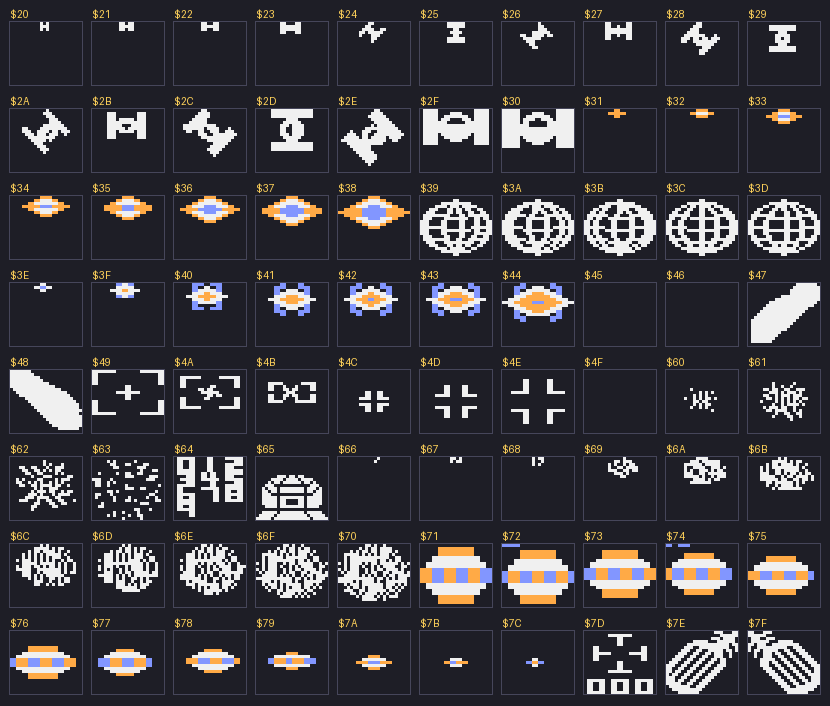
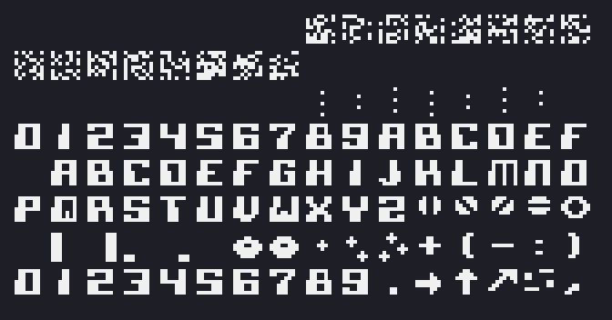
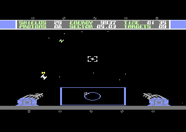

# Sentinel GUI assets and layout (C64 original)

Everything here is read from the C64 game (`Sentinel-1351_v8`) so the C128 port can
rebuild the cockpit. `python c128-gui/extract_sprites.py` regenerates the files in
`ref/` straight from the disk image; nothing has to be run in an emulator.

## Sprites (`ref/sprites-4800.bin`, `ref/sprites-sheet.png`)

All shapes are in VIC bank 1, 64 bytes each, addressed by a sprite pointer
(address = `$4000 + pointer * 64`). They are plain data in the disk image and
identical to the running game, so there is nothing to generate:

| pointers | address | what it is |
|---|---|---|
| `$20-$30` | `$4800-$4C3F` | enemy twin-pod fighters, tiny to close, in several rotations |
| `$31-$38` | `$4C40-$4E3F` | enemy ships (lens-shaped), one shape per distance (tiny to big); **multicolor** (user) |
| `$39-$3D` | `$4E40-$4FFF` | the planet, five globe frames (`$39-$3C` are cycled, see below) |
| `$3E-$44` | `$4F80-$513F` | small spiky shapes, growing: the shot; **multicolor** (user) |
| `$45`, `$46` | `$5140-$51BF` | blank on disk, **filled at run time** (see below) |
| `$47`, `$48` | `$51C0-$523F` | two big diagonal arms, mirrored: the gun barrels (left, right) |
| `$49-$4B` | `$5240-$52FF` | the tracking crosshair, animated |
| `$4C-$4E` | `$5300-$53BF` | corner marks, three sizes (crosshair at distance) |
| `$60-$63` | `$5800-$58FF` | explosion, four growing frames |
| `$64` | `$5900` | the digits 0-9, 8x5 pixels each: the source of the numbers shown in the three squares of `$7D` (user) |
| `$65` | `$5940` | the gun base, a dome (user) |
| `$66-$70` | `$5980-$5C3F` | enemy fire, growing as it approaches (tiny dots `$66-$68`, then blobs `$69-$70`) |
| `$71-$7C` | `$5C40-$5F3F` | mines or drones, one shape per distance (big to tiny); **multicolor** (user) |
| `$7D` | `$5F40` | the main cursor (crosshair), with three small squares underneath for numbers taken from the digits in `$64` |
| `$7E`, `$7F` | `$5F80-$5FFF` | the guns: left (`$7E`) and right (`$7F`), mirrored |

Pointers `$50-$5F` are the text screen (`$5400`), `$00-$1F` the character set and
colour matrix, `$80-$FF` the bitmap, so nothing else in the bank is a sprite.

Names are my reading of the shapes; they are not from the game. What the code
confirms (writes to the pointer shadow `$B0-$B7`, copied to `$47F8-$47FF` by the
raster interrupt):

- **sprite 0 is the crosshair** (`$1290-$12E0`): position from `$1209` / `$120A`,
  pointer `$7D` normally; while a target is tracked (`$5C` non-zero) it steps
  `$49`, `$4A`, `$4B`, `$49` every 16th frame (`$A0 & 15 == 0`), via the counter
  at `$1270`. This is what the user described;
- **the guns** are sprites 0 and 3 in the lower raster split (`$1225-$1262`): `$7E` is
  written to `$47F8` (sprite 0, the left gun) and `$7F` to `$47FB` (sprite 3, the right
  gun, X above 255 via `$D010` bit 3). Both are gray (`$0C`); while firing (`$D2`
  non-zero) one of them turns red (`$02`), alternating left and right (`$1418`).
  The same two slots are the crosshair higher up the screen;
- **enemy fire** is the sequence `$66` to `$70` (`$28D6` starts a shot at `$66`,
  `$2940` steps the pointer up, `$2D23` / `$2D67` compare with `$70`): the shot
  grows as it approaches;
- **mines or drones** approach as `$7C` stepping down to `$71` (`$CCDF`, `$CD27`), so they grow;
- sprite 1 is the planet on the map (pointers `$39-$3C`, every 8th frame) and is
  reused in flight for enemy fire and the basestar;
- sprites 5 and 6 get pointers `$45` / `$46`, which are blank on disk: at `$CF64`
  the game copies 128 bytes (two shapes) from a table into `$5140-$51BF` and
  steps through the table, with both sprites X-expanded. It looks like a close
  approach / ramming animation after which the ship is hit five times (`$84D7`);
- sprite 4 gets `$4C` (`$374C`);
- `$47` / `$48` (the two big diagonal arms) are not set by any constant in the
  code; they may be the barrels of the gun base, or drawn some other way. To do.

## Font (`ref/charset-4000.bin`, `ref/charset-sheet.png`)

The game has one font: the character set at `$4000` (128 characters, 8 bytes each).
The text screen (`$5400`, character set `$4000`, `D018` = `$50`) uses it for the HUD, and
the title, menu and messages are the *same glyphs* expanded to double width into the
bitmap (`$9BE5`, like the map icons). Codes `$00-$1F` are data, not glyphs; the
glyphs start at `$20` (digits and hex letters), then the letters, symbols (planet,
saucers, arrows) and a second set of digits.

## The cockpit as the game builds it

The raster interrupt (table at `$0A42`) switches the video mode five times per frame:
a text strip on top (screen `$5400`, character set `$4000`), the multicolor bitmap
(`$6000`, matrix `$4400`) for the 3D view, and a text strip at the bottom again
(`$D011` = `$3B` / `$1B`, `$D018` = `$18` / `$50`).

- **Upper HUD** (text screen `$5400`, row 0 is a border line):
  - row 1: `SHIELDS` (col 1, value at col 10-11, `$5432`), `ENERGY` (col 14), `TIME`;
  - row 2: `PROTONS` (col 1), `SECTOR` (col 14, written `05.03`), `TARGETS` (col 28);
  - row 3: a chequered border.
  See `ref/cockpit-text-layer.png`.
- **Lower part**: a strip of tick marks and rivets from the text layer, and the radar
  viewport and the two gun emplacements, which are part of the bitmap, not text.
  See `ref/cockpit-flight.png`.

## Not done yet

- Where the numbers in the squares of `$7D` come from (digits copied from `$64`, per the
  user) and what they show; `$47` / `$48`; the player's shot (`$3E-$44`) in the code.
- The data behind the run-time sprites `$45` / `$46` (table at `($5D)`, `$CF64`).
- The rest of the lower GUI: the radar contents, the emplacements as bitmap data.
